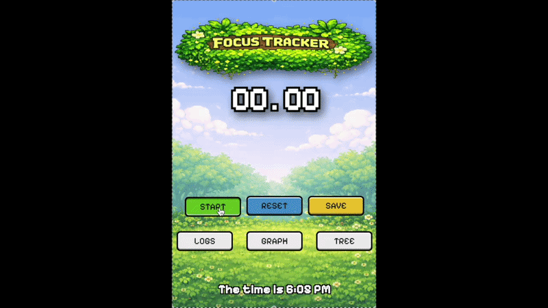

# FocusTracker

A Chrome extension that tracks your study time and turns a daily focus habit into a growing tree.

Start the timer when you sit down to work and save the session when you're done. FocusTracker logs your sessions, charts your week, and grows a pixel-art tree for each day you keep your streak going.

**[Install from the Chrome Web Store →](https://chromewebstore.google.com/detail/focus-tracker/onbbcniiimnbnbjcfidlijnmmopimokn)**

<p align="center">
  
</p>

**Built with:** React 19 · TypeScript · Vite · Chart.js · Chrome Extensions API (Manifest V3)

## Features

- **Focus stopwatch**: Start, stop, reset, and save sessions. The timer keeps running after the popup is closed.
- **Study log**: Sessions are grouped by day with daily totals. Expand a day to see each session's start time and length. The log is paginated at 7 days per page.
- **Weekly graph**: A line chart of focus minutes for the last 7 days, plus your daily average.
- **Streak tree**: Every day with at least 25 minutes of focus extends your streak, and the tree grows through 10 stages.
- **Private by default**: All data stays in `chrome.storage.local`. The only permission requested is `storage`.

## How it works

**A timer that survives the popup closing.** A Chrome extension popup is destroyed as soon as it loses focus, so the stopwatch can't live in React state. Instead, the timer runs in a Manifest V3 background service worker. The popup and the worker never call each other directly; they communicate through `chrome.storage`. The popup writes a flag such as `isRunning` or `end`, the worker reacts through `chrome.storage.onChanged`, and the popup reads the updated time back. Elapsed time is calculated from a stored start timestamp, not by counting ticks, so it stays accurate even if the interval timer drifts.

**Streak tracking.** When a session is saved, the worker totals that day's sessions. Once a day reaches 25 minutes, it's recorded as a streak day that links to the previous day's entry. A day missed in between restarts the count. The worker checks both today and yesterday, so a session that runs past midnight still counts toward the day it started.

**Data aggregation.** Sessions are stored as a flat list of `{ dayKey, duration, sessStart }` records. The log groups and paginates them by day. The graph builds a continuous 7-day window and fills days with no sessions with zero, so the chart has no gaps.

**Build setup.** Vite is configured with two entry points, the popup UI and the background worker. The worker is emitted as `background.js` so the manifest can reference it at a fixed path.

## Run it locally

To just use the extension, install it from the [Chrome Web Store](https://chromewebstore.google.com/detail/focus-tracker/onbbcniiimnbnbjcfidlijnmmopimokn). To build it from source, you need [Node.js](https://nodejs.org/) and Chrome (or another Chromium-based browser).

```bash
git clone https://github.com/philisawesome/Study-Tracker--Chrome-Extension.git
cd Study-Tracker--Chrome-Extension/studyTracker
npm install
npm run build
```

1. Open `chrome://extensions` and turn on **Developer mode**.
2. Click **Load unpacked** and select `studyTracker/dist`.
3. Pin FocusTracker to your toolbar.

## Project structure

```
studyTracker/
├── popup.html              # Popup entry point
├── public/
│   ├── manifest.json       # Extension manifest (MV3)
│   ├── images/             # Icons and backgrounds
│   └── treePngs/           # Tree growth stages
└── src/
    ├── background.ts       # Service worker entry
    ├── background/
    │   ├── stopwatch.ts    # Timer state and session saving
    │   └── streak.ts       # Daily streak calculation
    ├── popup/              # Pages: Home, Log, Graph, Tree
    ├── components/         # Stopwatch, log table, chart, tree, nav buttons
    ├── styles/
    └── types/
```
